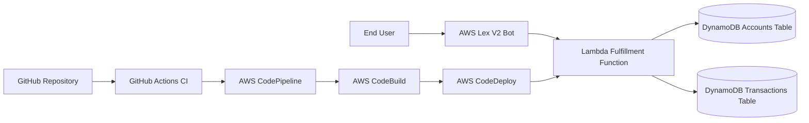

# Banking Chatbot with AWS Lex and CI/CD Automation

This repository contains a production-oriented structure implementation of a banking chatbot project built with **AWS Lex**, **AWS Lambda**, **Amazon DynamoDB**, and a CI/CD path using **GitHub Actions**, **AWS CodeBuild**, **AWS CodeDeploy**, and **AWS CodePipeline**.

## Project Goals

- Build an intelligent banking chatbot for 24/7 customer support.
- Use NLP intent recognition through AWS Lex.
- Connect Lex intents to backend logic in Lambda.
- Persist account and transaction data in DynamoDB.
- Automate testing and deployment with GitHub Actions and AWS developer tools.

## Repository Structure

```text
.
├── .github/workflows/ci-cd.yml          # GitHub Actions workflow
├── docs/                                # Project documentation
│   ├── architecture.md
│   ├── setup.md
│   ├── operations.md
│   └── tutorial/
│       ├── lex1.md
│       ├── lex2.md
│       ├── lex3.md
│       ├── lex4.md
│       └── lex5.md
├── infra/
│   └── cloudformation/
│       └── chatbot-stack.yaml           # AWS infrastructure template
├── scripts/
│   ├── package_lambda.sh                # Packages Lambda artifact
│   └── deploy_pipeline.sh               # Creates/updates CFN stack
├── src/banking_chatbot/fulfillment.py            # Lex fulfillment Lambda
├── tests/test_fulfillment.py            # Unit tests
├── appspec.yml                          # CodeDeploy spec for Lambda
├── buildspec.yml                        # CodeBuild build/test/package steps
└── requirements.txt                     # Runtime dependencies
```

## Architecture Overview



See [`docs/architecture.md`](docs/architecture.md) for component-level details.

## Quick Start

1. Read [`docs/setup.md`](docs/setup.md).
2. Follow tutorial stage guides in [`docs/tutorial`](docs/tutorial).
3. Run tests locally:

```bash
python -m unittest discover -s tests -p "test_*.py"
```

## Deployment Artifacts

- **CloudFormation**: `infra/cloudformation/chatbot-stack.yaml`
- **CodeBuild**: `buildspec.yml`
- **CodeDeploy**: `appspec.yml`
- **GitHub Actions**: `.github/workflows/ci-cd.yml`

## Notes

- The Lambda code is intentionally structured for testability and can be expanded for additional banking intents.
- Lex bot resources can be created in the AWS Console or via IaC in later iterations.
