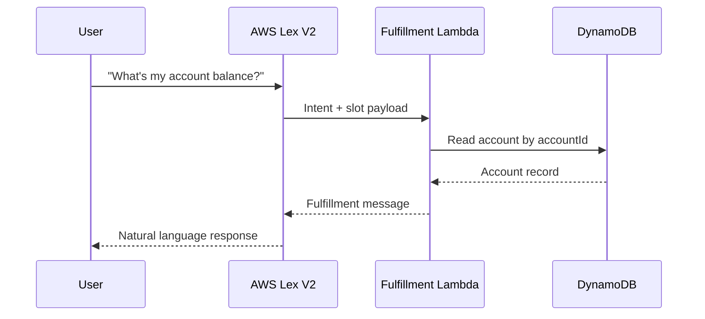
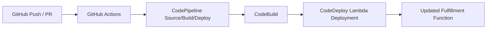

# Architecture

## Core Runtime Architecture

The chatbot runtime consists of:

1. **AWS Lex V2 Bot** for intent classification and slot collection.
2. **AWS Lambda fulfillment function** (`src/banking_chatbot/fulfillment.py`) for business logic.
3. **DynamoDB accounts table** for account balances.
4. **DynamoDB transactions table** for recent transaction lookups.

### Runtime Interaction

## CI/CD Architecture

## Security and Reliability Baselines

- IAM role uses least privilege access to DynamoDB and CloudWatch logs.
- Runtime configuration is provided through environment variables.
- Unit tests gate packaging in both GitHub Actions and CodeBuild.
- Deployment workflow supports repeatable releases through infrastructure templates.
